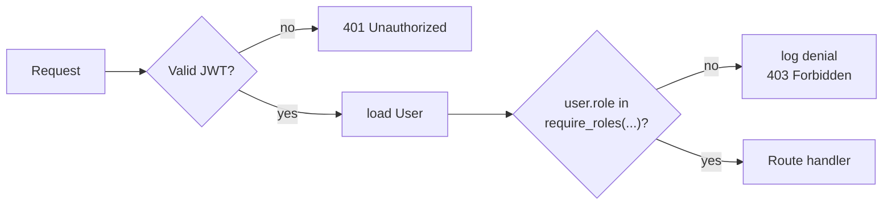

# Full Stack FastAPI Template

[](../../actions/workflows/test-docker-compose.yml)
[](../../actions/workflows/test-backend.yml)

## Technology Stack and Features

- ⚡ [**FastAPI**](https://fastapi.tiangolo.com) for the Python backend API.
  - 🧰 [SQLModel](https://sqlmodel.tiangolo.com) for the Python SQL database interactions (ORM).
  - 🔍 [Pydantic](https://docs.pydantic.dev), used by FastAPI, for the data validation and settings management.
  - 💾 [PostgreSQL](https://www.postgresql.org) as the SQL database.
- 🚀 [React](https://react.dev) for the frontend.
  - 🧩 Built into the backend application and served by FastAPI on the same domain as the API.
  - 💃 Using TypeScript, hooks, [Vite](https://vitejs.dev), and other parts of a modern frontend stack.
  - 🎨 [Tailwind CSS](https://tailwindcss.com) and [shadcn/ui](https://ui.shadcn.com) for the frontend components.
  - 🤖 An automatically generated frontend client.
  - 🧪 [Playwright](https://playwright.dev) for end-to-end testing.
  - 🦇 Dark mode support.
- ☁️ [FastAPI Cloud](https://fastapicloud.com) for deployment.
- 🐋 [Docker Compose](https://www.docker.com) for local services and self-hosted deployment.
  - 📞 [Traefik](https://traefik.io) as a reverse proxy with automatic HTTPS.
- 🔒 Secure password hashing by default.
- 🔑 JWT (JSON Web Token) authentication.
- 📫 Email-based password recovery.
- ✉️ [React Email](https://react.email) for email templates.
- 📬 [Mailpit](https://mailpit.axllent.org) for local email testing during development.
- ✅ Tests with [Pytest](https://pytest.org).
- 🏭 CI (continuous integration) and CD (continuous deployment) based on GitHub Actions.

### Dashboard Login


### Dashboard - Admin


### Dashboard - Items


### Dashboard - Dark Mode


### React Email Templates


### Mailpit - Local Email Testing


### Interactive API Documentation


## Role-Based Access Control (RBAC)

This fork adds three roles — `admin`, `manager`, `member` — enforced on the backend
and mirrored in the frontend for UX. Design decisions are recorded in
[docs/adr/001-role-model.md](./docs/adr/001-role-model.md) and
[docs/adr/002-frontend-capability-propagation.md](./docs/adr/002-frontend-capability-propagation.md);
deliberate scope cuts in [NOTES.md](./NOTES.md).

### Permission matrix

| Action | admin | manager | member |
|---|---|---|---|
| List users (`GET /users/`) | ✓ | ✓ | ✗ |
| Read any user (`GET /users/{id}`) | ✓ | ✓ | self only |
| Create user (`POST /users/`) | ✓ | ✗ | ✗ |
| Update/delete any user | ✓ | ✗ | ✗ |
| Metrics (`GET /metrics/summary`) | ✓ | ✓ | ✗ |
| Settings (`GET/PUT /settings/`) | ✓ | ✗ | ✗ |
| Own profile view/update (`/users/me`) | ✓ | ✓ | ✓ |

Semantics: **401** for missing/invalid credentials, **403** for authenticated but not
permitted. Every denial is logged with user id and route. Public `POST /users/signup`
stays open and always assigns `member`.

### How it works

- `role` is a single enum column on `User` and the sole source of truth for
  authorization (`is_superuser` is kept only for template compatibility).
- The role→permission mapping lives in one module:
  [backend/app/api/permissions.py](./backend/app/api/permissions.py).
- Routes are guarded declaratively with the `require_roles(*roles)` dependency
  factory in [backend/app/api/deps.py](./backend/app/api/deps.py) — no inline role
  checks in route bodies.



### Seeding roles

- The first superuser (`FIRST_SUPERUSER` / `FIRST_SUPERUSER_PASSWORD` in `.env`) is
  created with `role=admin` on prestart.
- New signups get `role=member`.
- To create a manager, log in as the admin and either use the API
  (`PATCH /api/v1/users/{id}` with `{"role": "manager"}`) or run:
  `docker compose exec db psql -U postgres -d app -c "UPDATE \"user\" SET role='manager' WHERE email='...'"`.

### Running the RBAC tests

```bash
docker compose up -d db mailpit
cd backend && uv run bash scripts/test.sh
```

The role×endpoint matrix lives in
[backend/tests/api/routes/test_rbac.py](./backend/tests/api/routes/test_rbac.py).

## How to Use It

Click the **Use this template** button at the top of this page to create a new repository.

## Backend Development

Backend docs: [backend/README.md](./backend/README.md).

## Frontend Development

Frontend docs: [frontend/README.md](./frontend/README.md).

## Deployment

FastAPI Cloud deployment: [deployment.md](./deployment.md).

Self-hosted deployment with Docker Compose: [deployment-docker-compose.md](./deployment-docker-compose.md).

## Development

General development docs: [development.md](./development.md).

This includes the local FastAPI and Vite workflow, Docker Compose services, `.env` configuration, and more.

## Release Notes

Check the file [release-notes.md](./release-notes.md).

## License

The Full Stack FastAPI Template is licensed under the terms of the MIT license.
